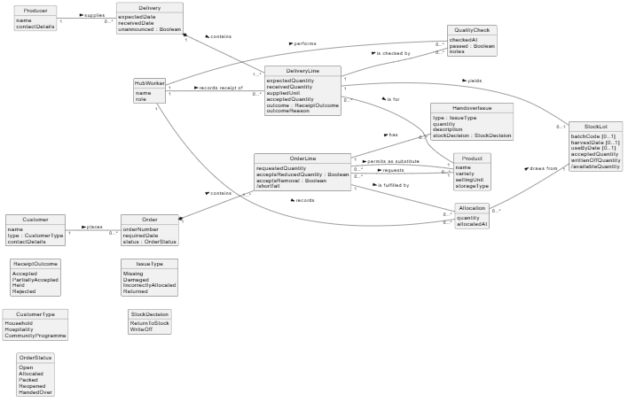

# 9. Domain Analysis

## 9.1 Candidate-concept analysis

Candidates were extracted from every noun and noun phrase in the scenario and stakeholder quotes, then classified. Decisions: **Keep** (becomes a class), **Merge** (synonym), **Convert** (attribute, association, status or enumeration), **Remove** (out of scope, technology or too vague).

| ID | Candidate | Source | Classification | Decision | Rationale |
|----|-----------|--------|----------------|----------|-----------|
| C-01 | Producer | Throughout | Conceptual class | Keep | Supplies deliveries; needed for traceability and contribution reports |
| C-02 | Small occasional supplier | Producers section | Synonym | Merge → Producer | Same concept; inconsistency is handled by optional batch attributes |
| C-03 | Product | Throughout | Conceptual class | Keep | Requested, delivered and substituted |
| C-04 | Variety, size, production method, packaging | Producers section | Attribute | Convert → Product attributes | Distinguish similar products; no identity of their own (`variety` kept; others deferred) |
| C-05 | Unit (weight, box, case, individual) | Producers section | Attribute | Convert → `sellingUnit`, `suppliedUnit` | Conversion rules unknown (Q-02); a separate class would invent policy |
| C-06 | Expected delivery | Producers section | Synonym | Merge → Delivery | An expected delivery becomes a received one; modelled as one Delivery with dates |
| C-07 | Delivery | Receipt section | Conceptual class | Keep | Groups lines from one producer arrival |
| C-08 | Delivery line | Implied by "partially accepted" | Conceptual class | Keep | Outcomes differ per product within one delivery (E-02) |
| C-09 | Expected / received / accepted quantity | E-02 | Attribute | Convert → DeliveryLine attributes | Values of one line at different stages |
| C-10 | Available quantity | E-04 | Attribute (derived) | Convert → `/availableQuantity` on StockLot | Calculated from accepted, allocated and written-off quantities (NFR-04) |
| C-11 | Accepted / partially accepted / held / rejected | Receipt section | Status | Convert → ReceiptOutcome enumeration | States of a delivery line |
| C-12 | Quality check / inspection | E-04; Receipt section | Conceptual class | Keep as QualityCheck | Has its own time, result and person; a line may be checked more than once |
| C-13 | Grade | Receipt section | Attribute | Remove (deferred) | Grading rules are not described; covered by `outcomeReason` |
| C-14 | Batch | E-07 | Conceptual class | Keep as StockLot | The accepted quantity from one line, with batch and dates, is the unit that is allocated and traced |
| C-15 | Harvest information, use-by date | Producers section | Attribute | Convert → StockLot attributes | Optional because producer records vary (A-03) |
| C-16 | Stock | Throughout | Synonym | Merge → StockLot | "Stock" is the set of all stock lots |
| C-17 | Storage (chilled, ambient, temporary) | Receipt section | Attribute | Convert → Product `storageType` | Storage capacity is out of scope; only the required type matters |
| C-18 | Customer | Throughout | Conceptual class | Keep | Places orders and holds preferences |
| C-19 | Household, café, accommodation provider, community programme | Organisation; Orders sections | Attribute | Convert → CustomerType enumeration | Same data and behaviour in the model; differences are only priority, which is unconfirmed (Q-05) |
| C-20 | Pre-paid household box | Orders section | Attribute | Remove (deferred) | Payment is out of scope; treated as a household order |
| C-21 | Order | Throughout | Conceptual class | Keep | Unit of preparation and handover |
| C-22 | Order line | Implied by "several products" | Conceptual class | Keep | Allocation and preferences apply per product |
| C-23 | Substitution preference | E-05 | Association | Convert → "permits as substitute" OrderLine–Product | A list of acceptable products, not a thing with its own data |
| C-24 | Reduced quantity, removal | E-06; Orders section | Attribute | Convert → OrderLine Booleans | Simple yes/no customer choices |
| C-25 | Allocation | Orders section | Conceptual class | Keep | Links a quantity of a stock lot to an order line; the basis of traceability (BR-03) |
| C-26 | Shortage / shortfall | Orders section | Attribute (derived) | Convert → `/shortfall` on OrderLine | Requested minus allocated quantity |
| C-27 | Priority rule | Orders section | Business rule | Remove from model | Unconfirmed policy (Q-05); belongs in the uncertainty register |
| C-28 | Label | Orders section | Attribute | Remove | A physical output of packing, not tracked data |
| C-29 | Collection / handover | Collection section | Status | Convert → OrderStatus `HandedOver` | A state of the order |
| C-30 | Missing / damaged / incorrectly allocated goods | Collection section | Conceptual class | Keep as HandoverIssue | Each issue has a type, quantity and decision |
| C-31 | Return | Collection section | Synonym | Merge → HandoverIssue (type Returned) | Same data: quantity and stock decision |
| C-32 | Staff, volunteer, hub manager | Throughout | Role | Convert → HubWorker with `role` | Needed to record who made decisions (NFR-05); roles do not need separate classes |
| C-33 | Driver | Collection section | Role | Remove | Offstage; does not record anything |
| C-34 | Price adjustment, commercial terms | Receipt; Collection sections | Out of scope | Remove | Payment excluded; A-07 records only a note via `outcomeReason` |
| C-35 | Spreadsheet, message, paper checklist | Organisation section | Technology | Remove | Current tools, not domain concepts |
| C-36 | Route, certification | Collection section | Out of scope | Remove | Explicitly excluded |
| C-37 | Report / producer contributions | Collection section | Derived information | Remove | Derived from existing classes (FR-13); meaning unconfirmed (Q-10) |

## 9.2 Glossary

| Term | Definition | Synonyms / notes |
|------|------------|------------------|
| Allocation | A quantity from one stock lot assigned to one order line | — |
| Available quantity | Accepted quantity of a stock lot minus allocated and written-off quantities | Derived; never includes held goods (BR-01) |
| Delivery | One arrival of goods from a producer, expected or unannounced | "Expected delivery" (merged) |
| Delivery line | One product within a delivery, with its expected, received and accepted quantities and outcome | — |
| Held | Received but not yet released by a quality check; not available | — |
| Handover issue | A problem found at collection (missing, damaged, wrongly allocated) or a returned item, with its stock decision | "Return" (merged) |
| Order | A customer's request for several products for a required date | — |
| Order line | One product within an order, with requested quantity and the customer's preferences | — |
| Permitted substitute | A product the customer has agreed may replace the ordered product | Substitution preference |
| Producer | A farm or business that supplies goods to the hub | "Supplier" (merged) |
| Quality check | A recorded inspection of a delivery line that releases or rejects held goods | Inspection |
| Selling unit | The unit in which the hub sells and allocates a product | Conversion rules open (Q-02) |
| Shortfall | Requested quantity of an order line minus its allocated quantity | Shortage |
| Stock lot | The accepted goods from one delivery line, with batch and date details, that can be allocated | Batch, stock |

## 9.3 Domain model

Source: `diagrams/domain-model.puml`. 12 conceptual classes, 5 enumerations.

**Modelling decisions**

1. **DeliveryLine is separate from Delivery.** One delivery can be partly accepted, held and rejected (Receipt section), so the outcome and quantities must belong to each line.
2. **StockLot is separate from DeliveryLine.** A delivery line records what happened at receipt; a stock lot is what can be allocated and traced. Only accepted goods yield a stock lot (multiplicity 0..1), which enforces BR-01 structurally.
3. **Allocation is a class, not a plain association.** It carries its own quantity and time, and one order line can draw from several lots (GH-05). This is what keeps the producer and batch link after stock is split (E-07, BR-03).
4. **Substitution is an association** ("permits as substitute") between OrderLine and Product, because a preference is a list of acceptable products with no data of its own.
5. **Customer types are an enumeration**, not subclasses: the scenario gives no difference in data or behaviour between them, only in priority, which is unconfirmed (Q-05).
6. **Quantities and units stay as attributes.** Modelling a Unit class with conversion factors would invent a policy the hub has not confirmed (Q-02).

**Model limitations:** priority rules, price adjustments and producer contribution reporting are not represented because their meaning is unresolved (Q-05, Q-08, Q-10).
